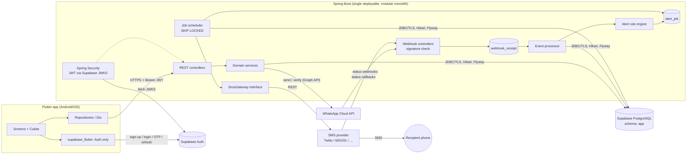
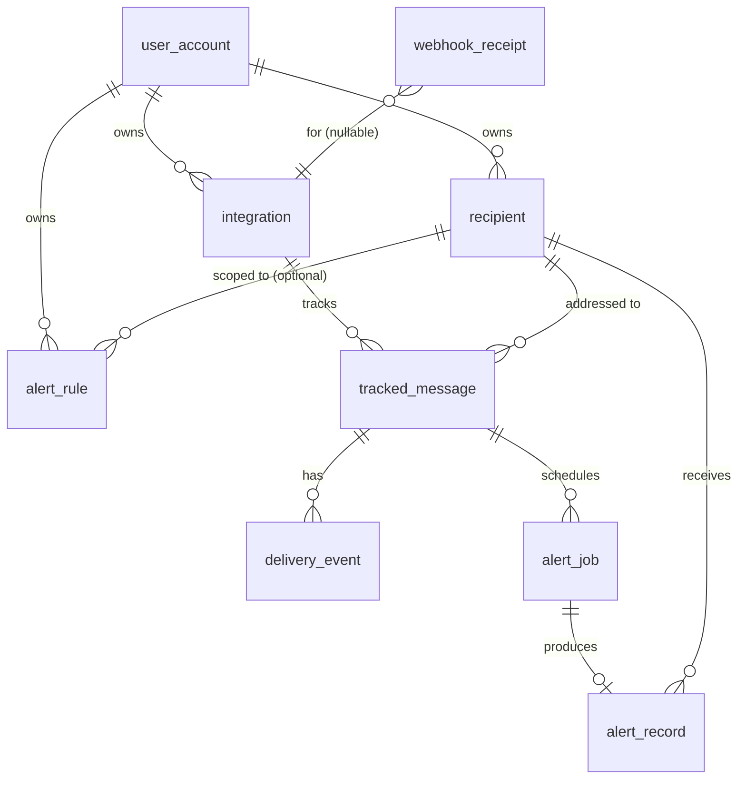

# Offline Message Alert Service — Feasibility Report & Architecture (Phase 0)

| | |
|---|---|
| Status | **Draft for approval. Nothing below is implemented yet.** |
| Date | 2026-10-29 |
| Scope | Deliverables 1–6 from the brief (feasibility, architecture, DB design, API outline, structure, plan), plus costs and risks |

Labels used throughout:
- **[VERIFIED]**: confirmed against the official documentation cited in §10.
- **[INFERRED]**: my reasoning from verified facts, not stated by the vendor.
- **[UNVERIFIED]**: plausible but not confirmed. Must be checked before we build on it.

---

## 0. Executive summary

1. **The original scenario, where Person A sends Person B a message from a personal WhatsApp, Telegram, Messenger or Signal account, cannot be monitored legitimately.** None of these platforms offers an API that exposes delivery status for messages sent from a personal account. Reading that status would require notification scraping, accessibility-service abuse or reverse-engineered clients, and the brief rules all of those out.
2. **Delivery status is available only when the *sender is a business integration*.** That means WhatsApp Business Platform (Cloud API), Messenger Platform (Pages), Google RCS Business Messaging and Viber bots. In each case the alert works only for messages the business sends **through that integration**.
3. **Telegram is not viable for automatic detection.** The Bot API exposes no delivered or read status for messages a bot sends.
4. **Recommendation: an MVP with two tracks behind one rules engine:**
   - **Track A (personal use, works today on every platform): user-triggered "nudge".** Person A taps "Alert Bob" in our app, optionally with a delay ("alert in 30 min unless I cancel"). The backend applies consent, rate limits and the delay, then sends Bob a neutral SMS. This is the only legitimate way to serve the original personal-chat scenario.
   - **Track B (business senders): WhatsApp Cloud API delivery-status monitoring.** Webhook statuses `sent`/`delivered`/`read`/`failed` plus a configurable timeout trigger an SMS fallback. This is the one fully automatic integration I propose for the MVP.
5. Each track is valid on its own. You need to choose which ships first (see §9, decision D1).

---

## 1. Platform comparison (deliverable 1.1)

| Platform / API | Delivery-status events? | Personal or business | Mechanism | Approval and prerequisites | Usable for automatic SMS fallback? |
|---|---|---|---|---|---|
| **WhatsApp consumer app (personal)** | **No API** | Personal | — | — | **No** |
| **WhatsApp Business Platform – Cloud API** | **Yes**: `sent`, `delivered`, `read`, `played`, `failed` [VERIFIED] | Business only (WABA + registered business number) | `messages` webhook, `statuses[]`, signed with `X-Hub-Signature-256` | Meta Business account, app, verified business phone number, approved templates for messages outside the 24 h window; per-message fees | **Yes**, but only for messages the business sends via the API |
| WhatsApp Business **app** + Cloud API "coexistence" | App-sent messages are mirrored via `smb_message_echoes` [VERIFIED]. Whether *delivery statuses* are emitted for app-sent messages is **[UNVERIFIED]**. | Small business (WhatsApp Business app, not personal WhatsApp) | Embedded Signup through a Tech Provider / solution provider | Becoming a Meta Tech Provider, or using a BSP | Possible later. Needs verification and Tech Provider onboarding. |
| **Facebook Messenger Platform** | **Yes**: `message_deliveries` (watermark, sometimes `mids`) and `message_reads` [VERIFIED] | Facebook **Pages** only, not personal profiles | Page webhook | Meta app review, `pages_messaging` permission, 24 h standard messaging window | Partially. The recipient must already have messaged the Page, and SMS fallback also needs their phone number, which Messenger does not supply. |
| Instagram Messaging API | `messaging_seen` (read) only. No delivery event found. [VERIFIED for read; absence of delivery inferred] | Professional accounts | Webhook | Meta app review | **No** reliable "undelivered" signal |
| **Telegram Bot API** | **No**. No Update type reports delivery or read for bot-sent messages [VERIFIED] | Bots, plus Business connections | Webhook / getUpdates | None for bots | **No** |
| Telegram MTProto (user accounts) | Read state only, no "delivered to device" stage [INFERRED] | Personal | Full client login with the user's session | Automating a user account carries ToS and security risk | **No**. Rejected under the brief's rules. |
| **Google RCS Business Messaging** | **Yes**: `DELIVERED`, `READ`, `IS_TYPING`, plus `TTL_EXPIRATION_REVOKED` / `_REVOKE_FAILED` [VERIFIED] | Business agents | Webhook (user events), Pub/Sub (platform events) | Agent registration, brand verification, carrier launch approval per country | **Yes**. Google explicitly recommends SMS as the alternate channel for time-sensitive messages [VERIFIED] |
| **Viber REST Bot API** | **Yes**: `delivered`, `seen`, `failed` callbacks [VERIFIED] | Bots (commercial only since 5 Feb 2024) [VERIFIED] | Webhook signed with `X-Viber-Content-Signature` (HMAC-SHA256) | Commercial agreement with Viber or a partner. The user must subscribe to the bot first. | Yes technically, but costly and limited to bot subscribers |
| Signal / iMessage | No public API | Personal | — | — | **No** |

### What this means
- Every "yes" row is a **business sending to its customers**. That is the Business-Platform model, and Twilio, Infobip, Sinch and others already sell "WhatsApp → SMS fallback" as a feature [INFERRED from the market. Validate competitively before investing].
- **No row lets a third party monitor arbitrary personal chats.** WhatsApp Cloud API access does *not* grant access to anyone's personal WhatsApp.

---

## 2. Official docs, access restrictions and account requirements (deliverable 1.2)

### WhatsApp Business Platform (Cloud API), the proposed Track B integration
- **Status webhook values** [VERIFIED, status reference]:
  - `sent` means the message left WhatsApp's servers and "does not mean the message reached the user's device".
  - `delivered` means it reached the device.
  - `read` means it was displayed in an open chat.
  - `failed` comes with an `errors[]` array.
  - A `delivered` webhook may be skipped when `read` arrives immediately. **Treat `read` as implying `delivered`.**
- **TTL** [VERIFIED, template TTL doc]: undelivered messages are dropped after their TTL. The docs say to "assume the message was dropped" if no `delivered` arrives before the TTL, with a small buffer for late webhooks.

  | Template category | Default TTL | Configurable range |
  |---|---|---|
  | Authentication | 10 min | 30 s – 15 min |
  | Utility | 30 days | 30 s – 12 h |
  | Marketing | 30 days | 12 h – 30 days |

  The SMS fallback delay must be shorter than the TTL, or the delay must be aligned with it.
- **Pricing** [VERIFIED]:
  - Per-message pricing has applied since 1 Jul 2025, charged **only on delivery**, by category and recipient country.
  - **From 1 Oct 2026, service and in-window utility messages are charged.** Each business number gets 1,000 free service messages per month.
  - Outside the 24 h customer-service window, only approved templates can be sent.
- **Webhook authentication**: HMAC-SHA256 of the raw body using the App Secret, sent in `X-Hub-Signature-256`. Subscription uses the `hub.verify_token` handshake. [Standard Meta webhook behaviour. Confirm against the Graph API webhooks doc when implementing.]
- **Webhook retries**: Meta retries undelivered webhooks for up to 7 days, or 1 hour on "No Storage" numbers [VERIFIED]. Our endpoint must be idempotent.
- **Account requirements**:
  - Meta Business portfolio, a Meta developer app, a WhatsApp Business Account, and a phone number that is **not** simultaneously used on consumer WhatsApp. Coexistence covers the Business *app* only.
  - Business verification to lift messaging limits.
- **Terms**: allowed. Using delivery status to trigger a fallback on another channel is a standard pattern. Recipient opt-in for WhatsApp is still required under WhatsApp Business policy.

### Messenger Platform
- `message_deliveries` and `message_reads` are active, not deprecated [VERIFIED].
- Pages only. Needs app review and the 24 h messaging window.
- **Blocker for SMS fallback:** Messenger identifies users by Page-scoped ID (PSID), not phone number. The recipient's number would have to be collected separately, with consent.

### Telegram Bot API
- Update types include `message`, `business_message`, `message_reaction` and others. **None reports delivery or read of bot-sent messages** [VERIFIED].
- A successful `sendMessage` means only that Telegram accepted the message.

### Google RBM
- `DELIVERED` and `READ` arrive by webhook. TTL expiry and revoke events are also delivered [VERIFIED].
- Delivery is "not guaranteed", and Google recommends SMS for time-sensitive content.
- Requires a verified brand and carrier launch approval, so it is country-dependent.

### Viber Bot API
- `delivered`, `seen` and `failed` callbacks, signed with `X-Viber-Content-Signature` [VERIFIED].
- Commercial terms are mandatory since 5 Feb 2024, and users must subscribe to the bot first [VERIFIED].

---

## 3. What can and cannot be detected reliably (deliverable 1.3)

| Signal | Meaning | Reliability |
|---|---|---|
| WhatsApp `delivered` / `read` | The message reached the device / was displayed | High, as a **positive** signal |
| WhatsApp `failed` | Definitive failure, with an error code | High |
| WhatsApp `sent` with no `delivered` after N minutes | **Possibly** the phone is offline, switched off, out of coverage, the app was uninstalled, the user is blocked, or a webhook was lost or delayed | **Inference only.** Never "recipient is offline". |
| Telegram / Instagram "no receipt" | No information at all | None. We must not fabricate a status. |
| User-triggered nudge (Track A) | Person A *believes* Bob hasn't seen the message | Human judgement. The SMS says so honestly. |

**Rules the system must enforce:**
1. Store `confirmed_status` (from the platform) separately from `inferred_condition` (our timeout logic).
2. SMS copy says "may not have been delivered yet", never "is offline".
3. Lack of an event is never stored as a delivery status.
4. If a later `delivered` or `read` arrives before the alert fires, cancel the alert. If it arrives after, record it for analytics but never "un-send".

---

## 4. Proposed end-to-end workflows (deliverable 1.4)

### Track B: WhatsApp Cloud API delivery monitoring (automatic)

1. A business user connects their WABA in the app. The backend stores the WABA ID, phone-number ID and a reference to the access token (the secret itself lives in a secrets store), then verifies by calling the Graph API.
2. The business sends messages **through our backend's send endpoint, or through their own system using the same WABA with our webhook subscribed**. The backend records `(phone_number_id, wamid, recipient_e164)` with **no message body**.
3. A webhook arrives at `POST /webhooks/whatsapp`:
   - verify `X-Hub-Signature-256` over the raw bytes, and reject with 401 if invalid;
   - insert into `webhook_receipt`, unique on the payload hash, so replays become no-ops;
   - return 200 fast, then process asynchronously.
4. Each `statuses[]` entry is inserted into `delivery_event`, unique on `(integration_id, platform_message_id, status)`, and `tracked_message.current_status` is updated monotonically (`sent < delivered < read`, with `failed` terminal).
5. On `sent`, if an alert rule matches, the backend inserts `alert_job(run_at = sent_at + delay)`, unique on `(tracked_message_id, rule_id)`.
6. A scheduler polls due jobs with `SELECT … FOR UPDATE SKIP LOCKED`. In one transaction it:
   - re-checks the status (cancels if `delivered`/`read`);
   - checks recipient consent, opt-out and enabled flags, quiet hours, and the per-recipient rate limit;
   - creates an `alert_record` with a unique idempotency key.
7. Then the SMS is submitted via `SmsGateway`. The provider ID is stored and the status set to `ACCEPTED`. Later status callbacks move it to `DELIVERED`, `FAILED` or `UNKNOWN`.
8. Retries:
   - definite pre-acceptance errors (connection refused, 429, explicit 4xx) are retried with exponential backoff up to N attempts;
   - **ambiguous outcomes (timeout after the request was sent) are NOT auto-retried.** They are marked `UNKNOWN` and reconciled by querying the provider. This prevents duplicate SMS.

### Track A: user-triggered nudge (personal chats, any platform)

1. Person A opens the app, picks recipient Bob (a consented contact), picks a platform label ("WhatsApp") and an optional delay.
2. The backend validates ownership, consent, and rate limits (for example max 3 per recipient per 24 h and max 20 per user per day), then creates an `alert_job` with `trigger_source = USER_TRIGGERED`.
3. During the delay, A can cancel with "Bob replied" (`DELETE /alerts/{id}`).
4. When due, the same pipeline as Track B steps 6–8 runs.
5. SMS: *"[AppName]: Someone you know is trying to reach you on WhatsApp. Please check your messages when you can. Reply STOP to opt out."* Whether the sender's name appears is a per-user setting, off by default. It may be mandatory in some jurisdictions; see open question Q4.

### Recipient consent flow (both tracks)
When a recipient is added, the backend sends a one-time SMS: *"[AppName]: Alex wants to be able to alert you by SMS about missed messages. Reply YES to allow, STOP to opt out."*
- Alerts are blocked until the status is `OPTED_IN`.
- STOP is honoured globally across all users for that number, stored in a `phone_opt_out` table.
- For Track B, the business's own customer-consent records may substitute. This needs a legal check.

---

## 5. Architecture diagrams (deliverable 1.5)

### 5.1 Component architecture



### 5.2 Delivery event → SMS sequence (Track B)

```mermaid
sequenceDiagram
  participant WA as WhatsApp Cloud API
  participant WH as /webhooks/whatsapp
  participant DB as Supabase Postgres
  participant SCH as Scheduler
  participant SMS as SMS provider
  participant R as Recipient

  WA->>WH: POST statuses[sent] + X-Hub-Signature-256
  WH->>WH: HMAC verify (reject 401 if bad)
  WH->>DB: INSERT webhook_receipt ON CONFLICT DO NOTHING
  WH-->>WA: 200 OK
  WH->>DB: INSERT delivery_event(sent); UPSERT tracked_message
  WH->>DB: INSERT alert_job(run_at = sent_at + delay) ON CONFLICT DO NOTHING
  Note over WA,DB: if delivered/read arrives before run_at → job CANCELLED
  SCH->>DB: SELECT due jobs FOR UPDATE SKIP LOCKED
  SCH->>DB: re-check status, consent, rate limit → INSERT alert_record(idem_key)
  SCH->>SMS: send(to, template, clientRef = alert_record.id)
  SMS-->>SCH: 201 provider_message_id (ACCEPTED)
  SMS->>R: SMS
  SMS->>WH: status callback (delivered/failed)
  WH->>DB: UPDATE alert_record.sms_status
```

### 5.3 Authentication decision: **Supabase Auth** (one system, not two)

**Why:**
- The project already has Supabase.
- `supabase_flutter` gives us sign-up, login, password reset, phone OTP, refresh tokens and session handling, so we don't rebuild security-critical flows.
- The backend stays stateless.

**How:**
- Spring Security `oauth2ResourceServer().jwt()` with `jwk-set-uri = https://<ref>.supabase.co/auth/v1/.well-known/jwks.json`.
- Asymmetric signing keys (ES256 recommended; legacy HS256 shared secret not recommended) [VERIFIED].
- Validate `iss`, `aud=authenticated` and `exp`. Map `sub` to `app.user_account.id`.

**Rules:**
- Flutter holds **only** the publishable/anon key, used **only** for Auth calls.
- All data goes through Spring Boot. The service-role key and DB password stay server-side.
- Tables live in a non-exposed `app` schema with RLS enabled and no policies, so the Supabase Data API can never reach them.
- The backend connects as a dedicated least-privilege Postgres role (`alert_service`), not `postgres`.

---

## 6. Proposed database schema (deliverable 1.6 / brief deliverable 3)



All tables are in schema `app`. Timestamps are `timestamptz`. IDs are `uuid` (`gen_random_uuid()`).

| Table | Key columns | Constraints / indexes |
|---|---|---|
| `user_account` | `id` (= Supabase `auth.users.id`), `display_name`, `phone_e164`, `phone_verified_at`, `created_at`, `deleted_at` | PK. No password stored (Supabase Auth owns credentials). |
| `integration` | `id`, `user_id`, `platform` (`WHATSAPP_CLOUD`, `MANUAL`), `external_account_id` (WABA ID), `external_phone_id`, `secret_ref` (pointer, never the token), `status` (`PENDING`, `ACTIVE`, `AUTH_LOST`, `UNSUPPORTED`, `DISCONNECTED`), `last_verified_at`, `last_error` | `UNIQUE(platform, external_phone_id)`; `idx(user_id)` |
| `recipient` | `id`, `user_id`, `label`, `phone_e164`, `alerts_enabled`, `consent_status` (`PENDING`, `OPTED_IN`, `OPTED_OUT`), `consent_at`, `consent_evidence` | `UNIQUE(user_id, phone_e164)`; `CHECK (phone_e164 ~ '^\+[1-9][0-9]{6,14}$')` |
| `phone_opt_out` | `phone_e164` PK, `opted_out_at`, `source` | Global STOP list, checked before every send |
| `alert_rule` | `id`, `user_id`, `recipient_id` (nullable = default), `integration_id` (nullable), `delay_minutes`, `max_alerts_per_day`, `quiet_hours_start`/`end`, `timezone`, `enabled` | `CHECK (delay_minutes BETWEEN 1 AND 1440)` |
| `tracked_message` | `id`, `integration_id`, `recipient_id`, `platform_message_id` (wamid), `current_status`, `sent_at`, `delivered_at`, `read_at`, `failed_at`, `failure_code` | `UNIQUE(integration_id, platform_message_id)`; `idx(current_status, sent_at)`. **No message body.** |
| `delivery_event` | `id`, `tracked_message_id`, `status`, `platform_timestamp`, `received_at`, `error_code` | `UNIQUE(tracked_message_id, status)` makes duplicates no-ops |
| `webhook_receipt` | `id`, `source` (`WHATSAPP`, `SMS_PROVIDER`), `payload_sha256`, `signature_valid`, `received_at`, `processed_at`, `processing_state`, `attempts`, `last_error`, `payload_redacted` jsonb | `UNIQUE(source, payload_sha256)`; `idx(processing_state, received_at)` |
| `alert_job` | `id`, `trigger_source` (`DELIVERY_TIMEOUT`, `USER_TRIGGERED`), `tracked_message_id` (nullable), `recipient_id`, `rule_id`, `requested_by_user_id`, `run_at`, `state` (`SCHEDULED`, `RUNNING`, `DONE`, `CANCELLED`, `SKIPPED`, `FAILED`), `skip_reason`, `attempts`, `locked_until` | `UNIQUE(tracked_message_id, rule_id) WHERE tracked_message_id IS NOT NULL`; partial `idx(run_at) WHERE state='SCHEDULED'` |
| `alert_record` | `id`, `alert_job_id`, `recipient_id`, `idempotency_key`, `provider`, `provider_message_id`, `sms_status` (`QUEUED`, `ACCEPTED`, `SENT`, `DELIVERED`, `FAILED`, `UNDELIVERED`, `UNKNOWN`), `template_key`, `submitted_at`, `status_updated_at`, `error_code` | `UNIQUE(idempotency_key)`; `UNIQUE(alert_job_id)`; `idx(recipient_id, submitted_at)` for rate limiting |
| `audit_log` | `id`, `actor_user_id`, `action`, `entity`, `entity_id`, `at`, `meta` jsonb (no PII) | `idx(entity, entity_id)` |

**Migration plan (Flyway, `src/main/resources/db/migration`):**

| Migration | Contents |
|---|---|
| `V1__schema_and_roles.sql` | `app` schema, extensions, `alert_service` role grants (the role is created manually once in the dashboard) |
| `V2__core_tables.sql` | user, recipient, opt-out, rule |
| `V3__integration_and_events.sql` | |
| `V4__alerts_and_jobs.sql` | |
| `V5__rls_lockdown.sql` | Enable RLS on every table, revoke from `anon`/`authenticated` |

Migrations run over the **direct connection**. The app runtime uses the session pooler or direct connection.

**Retention:**

| Data | Retention |
|---|---|
| `webhook_receipt` | 30 days |
| `delivery_event` / `tracked_message` | 90 days |
| `alert_record` | 12 months (needed for disputes and opt-out evidence) |
| `phone_opt_out` | Kept indefinitely (legal requirement) |

Account deletion hard-deletes user-owned rows and keeps anonymised alert counts. All of this runs as a nightly job.

---

## 7. API outline (brief deliverable 4, detailed spec comes after approval)

Base path `/api/v1`. JSON responses, errors in RFC 7807 `application/problem+json` format. OpenAPI generated with springdoc.

| Group | Endpoints |
|---|---|
| Account | `GET /me`, `PATCH /me`, `DELETE /me` (data deletion) |
| Recipients | `GET/POST /recipients`, `GET/PATCH/DELETE /recipients/{id}`, `POST /recipients/{id}/consent-request` |
| Rules | `GET/POST /alert-rules`, `PATCH/DELETE /alert-rules/{id}` |
| Integrations | `GET /integrations`, `POST /integrations/whatsapp`, `POST /integrations/{id}/verify`, `DELETE /integrations/{id}`, `GET /platforms` (capability matrix, so the UI never shows fake support) |
| Alerts | `POST /alerts` (Track A nudge), `DELETE /alerts/{id}` (cancel scheduled), `GET /alerts?page=&size=` (history) |
| Dashboard | `GET /dashboard` |
| Webhooks (public, signature-verified, rate-limited) | `GET/POST /webhooks/whatsapp`, `POST /webhooks/sms/{provider}`, `POST /webhooks/sms/{provider}/inbound` (YES/STOP replies) |
| Ops | `/actuator/health` (public liveness), other actuator endpoints internal only |

---

## 8. Proposed project structure (brief deliverable 5)

```
offline-message-alert-service/
├── backend/                         # Spring Boot 3.x, Java 21, Gradle
│   └── src/main/java/com/oma/
│       ├── common/                  # errors, problem+json, clock, ids, security config
│       ├── account/                 # api / domain / persistence
│       ├── recipient/
│       ├── rule/
│       ├── integration/
│       │   ├── core/                # PlatformIntegration SPI, capability matrix
│       │   └── whatsapp/            # webhook controller, signature verifier, Graph client
│       ├── tracking/                # tracked_message, delivery_event, event processor
│       ├── alerting/                # rule engine, alert_job scheduler, alert_record
│       └── sms/                     # SmsGateway interface + twilio/, msg91/, fake/ adapters
├── mobile/                          # Flutter
│   └── lib/
│       ├── core/                    # di (get_it), dio client + auth interceptor, theme, router (go_router)
│       └── features/
│           ├── auth/        {data, domain, presentation(cubit, pages)}
│           ├── onboarding/
│           ├── dashboard/
│           ├── recipients/
│           ├── integrations/
│           ├── alert_rules/
│           ├── alert_history/
│           ├── settings/
│           └── help/
├── docs/
└── README.md
```

The backend is a modular monolith: one deployable with package-level module boundaries. There are no microservices, no Redis and no broker. Postgres is the job queue until volume proves otherwise.

---

## 9. Costs, limits and operations (deliverable 1.7)

### SMS (per 160-char GSM-7 segment; keep templates to one segment)

| Market | Example provider price | Notes |
|---|---|---|
| USA | Twilio $0.0083 + carrier fee ≈ $0.0035–0.005, so **≈ $0.012–0.013 / SMS** [VERIFIED, Oct 2026] | A2P **10DLC brand and campaign registration** (fees, weeks of vetting) or toll-free verification is mandatory |
| India | Twilio **$0.0832 / segment** [VERIFIED]. Domestic aggregators are typically far cheaper [UNVERIFIED, get quotes] | **TRAI DLT** registration of entity, header and *every template* is mandatory. Unregistered content is blocked. Needs an Indian legal entity / PAN. |
| Other | Varies widely | Sender-ID rules differ per country |

**Example:** 1,000 users × 10 alerts/month = 10k SMS ≈ **$125/month in the US**, ≈ $830/month via Twilio in India.

**Rate limits are a cost control, not just anti-spam.**

### WhatsApp (Track B)
- Charged per delivered template message, by category and country [VERIFIED].
- Undelivered messages are not charged, so a fallback SMS does not double-bill on the WhatsApp side.
- The business sender pays this, not us, if they use their own WABA.

### Supabase [VERIFIED]

| Plan | What you get | Fit |
|---|---|---|
| Free | 500 MB DB, shared CPU / 500 MB RAM, **paused after 1 week of inactivity**, no backups, 5 GB egress | Fine for development. **Not acceptable for production**: pausing breaks webhook processing, and there are no backups. |
| Pro | $25/month: 8 GB disk, Micro compute included, daily backups kept 7 days, never paused | **Required before go-live** |

**Connection:**
- Direct connection is IPv6-only unless you buy the IPv4 add-on.
- Most PaaS hosts are IPv4, so use the **session pooler (port 5432)** for the app, with Hikari `maximumPoolSize` around 5.
- Avoid transaction mode (port 6543) because of prepared statements.
- Run migrations over the direct connection where IPv6 works, otherwise over the session pooler.
- Always `sslmode=require`, ideally `verify-full` with the Supabase CA.

### Hosting the backend [UNVERIFIED prices, confirm at selection]
- It needs an **always-on** instance, because the scheduler and webhooks cannot scale to zero.
- Options: Render or Railway (≈ $7–20/month), Fly.io (≈ $5–15), Google Cloud Run with `min-instances=1` (≈ $15–30).
- Pick a region next to the Supabase region.

### Ongoing operations
- Uptime monitoring on `/actuator/health`.
- Alerting on webhook signature failures, job backlog age, SMS failure rate, and integrations in `AUTH_LOST`.
- Secret rotation for the WhatsApp token, SMS keys and DB password.
- DLT/10DLC template maintenance.
- Handling STOP and complaints.

**Baseline monthly cost:** ~$35–55 (Supabase Pro + small host) + SMS volume + domain.

---

## 10. Milestone plan (deliverable 1.8)

| # | Milestone | Outcome |
|---|---|---|
| M0 | **Approval of this report** and decisions D1–D5 | Scope locked |
| M1 | Repo + backend skeleton | Gradle, Spring Boot, Flyway V1–V5 against Supabase, Spring Security JWT via JWKS, problem+json, OpenAPI, Testcontainers Postgres, CI |
| M2 | Recipients, consent, rules | CRUD APIs, E.164 validation (libphonenumber), consent SMS, YES/STOP inbound, global opt-out, authz tests (case 9) |
| M3 | SMS gateway + alert pipeline | `SmsGateway` SPI, fake + one real provider, `alert_job` scheduler (SKIP LOCKED), idempotency, retry policy, status callbacks (cases 4, 5, 6, 11) |
| M4 | **Track A: user-triggered nudge** | `POST /alerts` with delay and cancel, rate limits. **First end-to-end usable product.** |
| M5 | Flutter app v1 | Auth (supabase_flutter), onboarding, dashboard, recipients, rules, history, settings, help/limitations; Cubit + Dio; widget/cubit tests |
| M6 | **Track B: WhatsApp Cloud API** | Integration connect/verify, signed webhook, event processing, timeout rule, auto-cancel on delivered/read, AUTH_LOST detection (cases 1, 2, 3, 7, 8, 10) |
| M7 | Hardening and deploy | Rate limiting on webhooks, retention jobs, account deletion, Supabase Pro, hosting, monitoring, setup and deployment guides |

Each milestone ends with passing tests and a demo.

---

## 11. Open questions, decisions and risks (deliverable 1.9)

### Decisions I need from you
- **D1: Product direction.** Ship Track A (user-triggered nudge for personal chats) first, Track B (WhatsApp Business delivery monitoring) first, or both in the MVP? My recommendation is **A first (M4), then B (M6)**.
- **D2: Target country(ies) for SMS.** This decides the provider, compliance work (DLT in India, 10DLC in the US) and cost.
- **D3: SMS provider.** Twilio is the global default with the best docs. A local aggregator (e.g. MSG91 for India) is cheaper. The gateway interface allows both.
- **D4: Do you have, or can you obtain, a Meta Business portfolio + WhatsApp Business Account + a dedicated number** for Track B testing?
- **D5: Backend hosting provider** and the Supabase region.

### Open technical questions
- **Q1:** Does WhatsApp emit `delivered`/`read` statuses for messages sent from the WhatsApp Business *app* under coexistence? If yes, small businesses could keep using their phone. **[UNVERIFIED]**
- **Q2:** Track B messages sent by the business's *own* system on a WABA we don't control. Can multiple apps subscribe to the same WABA's webhooks, or must we proxy sends? (Webhook override / alternate callback docs suggest per-WABA routing exists. Needs confirmation.)
- **Q3:** The appropriate "no delivered" timeout per template category versus the TTL (for example, utility TTL max 12 h).
- **Q4:** Whether jurisdictions where SMS is sent require sender identification in the SMS body, and whether one user's consent request to a third party's number is itself permissible messaging. **Needs legal review.**
- **Q5:** Does the chosen SMS provider support idempotency keys? If not, ambiguous failures go to `UNKNOWN` plus reconciliation, as designed.

### Risks
| Risk | Impact | Mitigation |
|---|---|---|
| Users expect automatic detection for personal WhatsApp chats | Product disappointment | Clear in-app explanation and the capability matrix from `/platforms`. Track A positioning. |
| SMS abuse (harassing someone via nudges) | Legal/reputational | Recipient opt-in before any alert, global STOP, strict per-recipient limits, audit log, account suspension |
| Platform policy or pricing changes (e.g. WhatsApp charging changes on 1 Oct 2026) | Cost or feature loss | Integration SPI, monitor changelogs |
| Supabase free-tier pause | Lost webhooks | Pro plan before production |
| Duplicate SMS on retry | Spam, cost | Unique idempotency key, no blind retry on ambiguous outcomes |
| DLT/10DLC registration delays | Go-live slips by weeks | Start registration in M1, in parallel |
| Webhook loss during downtime | Missed alerts | Meta retries for 7 days, inbox table, idempotent processing |

---

## 12. Sources

**WhatsApp Business Platform**
- [Status webhook reference](https://developers.facebook.com/documentation/business-messaging/whatsapp/webhooks/reference/messages/status)
- [Template time-to-live](https://developers.facebook.com/documentation/business-messaging/whatsapp/templates/time-to-live)
- [Pricing](https://developers.facebook.com/documentation/business-messaging/whatsapp/pricing)
- [No Storage / webhook retry windows](https://developers.facebook.com/documentation/business-messaging/whatsapp/no-storage/)
- [Onboarding WhatsApp Business app users (coexistence, smb_message_echoes)](https://developers.facebook.com/documentation/business-messaging/whatsapp/embedded-signup/onboarding-business-app-users/)
- [Webhook payload examples](https://developers.facebook.com/docs/whatsapp/cloud-api/webhooks/payload-examples)
- [Webhook overrides](https://developers.facebook.com/documentation/business-messaging/whatsapp/webhooks/override)

**Messenger Platform**
- [message_deliveries](https://developers.facebook.com/documentation/business-messaging/messenger-platform/webhooks/webhook-events/message-deliveries)
- [message_reads](https://developers.facebook.com/documentation/business-messaging/messenger-platform/webhooks/webhook-events/message-reads.md)

**Other messaging platforms**
- [Telegram Bot API](https://core.telegram.org/bots/api)
- [Viber REST Bot API](https://developers.viber.com/docs/api/rest-bot-api/)
- [Google RCS Business Messaging: events](https://developers.google.com/business-communications/rcs-business-messaging/guides/build/events)

**Supabase**
- [Pricing](https://supabase.com/pricing)
- [Connecting to Postgres](https://supabase.com/docs/guides/database/connecting-to-postgres)
- [JWT signing keys](https://supabase.com/docs/guides/auth/signing-keys)

**SMS pricing and compliance**
- [Twilio SMS pricing (US)](https://www.twilio.com/en-us/sms/pricing/us)
- [Twilio SMS pricing (India)](https://www.twilio.com/en-us/sms/pricing/in)
- [India DLT overview (vendor guide, verify against TRAI)](https://www.telerivet.com/blog/india-sms-compliance-trai-dlt-registration-and-tcccpr-guide)
- [mGov DLT registration (PDF)](https://www.mgov.gov.in/Resources/SMS_DLT_reg.pdf)

Third-party sources used only as corroboration:
- [Sinch: Telegram delivery status](https://support.sinch.com/hc/en-us/articles/54629273499283-How-do-you-know-if-your-Telegram-messages-have-been-successfully-delivered)
- [tdesktop feature request #28345](https://github.com/telegramdesktop/tdesktop/issues/28345)
